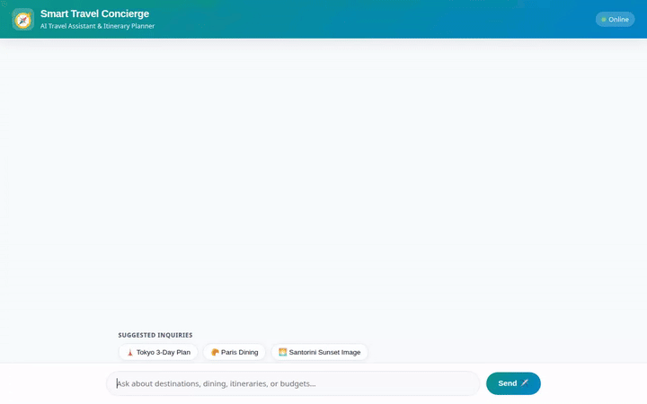

# Smart Travel Concierge ✈️🌴

An AI-powered travel assistant built with the **Google Agent Development Kit (ADK)**, **Gemini 2.5 Flash**, **Vertex AI Memory Bank**, **Firestore**, **Google Cloud Storage**, and **A2UI**.



---

## 🌟 Overview

**Smart Travel Concierge** helps travelers discover destinations, search nearby attractions, check real-time weather forecasts, generate custom destination artwork and videos, calculate multi-currency travel budgets, and remember personal travel preferences across sessions.

---

## 🛠️ Implemented Features & Google Cloud Services

This agent is built using the following integrated tools and services:

* **Vertex AI Memory Bank Service**: Persists user preferences, dietary restrictions, and allergies across chat sessions using `VertexAiMemoryBankService` and `PreloadMemoryTool`.
* **Cloud Firestore**: Queries and manages destination catalogs, categories, ratings, and daily estimated costs in a document database.
* **Cloud Storage (GCS)**: Stores generated media (images and videos) with public URLs for inline rendering.
* **Vertex AI Image Generation (`gemini-3.1-flash-lite-image`)**: Generates scenic destination artwork in the `global` region, saves ADK tool artifacts, and uploads directly to GCS.
* **Vertex AI Omni Video Generation (`gemini-omni-flash-preview`)**: Generates short travel videos using the Vertex AI Interactions API in the `global` region, saving ADK artifacts and uploading to GCS.
* **Agent Engine Sandbox Code Executor**: Runs Python code securely in a remote sandbox for travel calculations and budget analytics.
* **Agent-to-User Interface (A2UI v0.8)**: Generates structured, responsive UI display cards (destinations, weather, budgets) using `A2uiSchemaManager`.
* **Google Maps Platform APIs**:
  * **Geocoding API**: Converts place names and addresses into geographic coordinates (`latitude`, `longitude`).
  * **Places API (New)**: Performs `places:searchNearby` searches for local tourist attractions, restaurants, cafes, and landmarks.
* **Live Weather Integration**: Connects to the Open-Meteo REST API for live weather forecasts, temperatures, timezones, and population data.
* **Travel Budget Calculator**: Calculates trip budgets across currencies (`USD`, `EUR`, `JPY`, `GBP`, `CAD`) with per-person breakdowns.

---

## 📁 Project Structure

```text
smart-travel-concierge/
├── app/
│   ├── agent.py               # Core ADK agent, tools, callbacks, and Memory Bank setup
│   ├── a2ui_utils.py          # A2UI model callback for UI card rendering
│   └── fast_api_app.py        # FastAPI proxy application for A2A communication
├── frontend/
│   ├── main.py                # FastAPI proxy server powering custom chat UI
│   ├── templates/             # HTML chat interface with A2UI card renderer
│   └── static/                # CSS styles, fonts (Outfit & Inter), and icons
├── demo.gif                   # Looping demo recording preview
├── agent_demo.webm            # Full HD Playwright demo recording
├── agent_demo_music.webm      # HD Playwright demo recording with Lyria AI music
├── agents-cli-manifest.yaml   # Agent manifest configuration
└── pyproject.toml             # Python dependencies
```

---

## 🚀 Local Setup & Run Instructions

### Prerequisites

1. **Python 3.11+** installed.
2. **`uv` Package Manager**: Install with `curl -LsSf https://astral.sh/uv/install.sh | sh`.
3. **Google Cloud SDK (`gcloud`)**: Authenticated with your GCP project:
   ```bash
   gcloud auth login
   gcloud auth application-default login
   gcloud config set project <YOUR_GCP_PROJECT_ID>
   ```

### 1. Environment Setup

Create a `.env` file in the project root:

```bash
GOOGLE_CLOUD_PROJECT=<YOUR_GCP_PROJECT_ID>
GOOGLE_MAPS_API_KEY=<YOUR_GOOGLE_MAPS_API_KEY>
```

Install dependencies:

```bash
uv sync
```

### 2. Run the Agent Playground (Local ADK Web UI)

To test the agent with the ADK developer UI:

```bash
uv run adk web app:app
```

### 3. Run the Custom Web Frontend

To launch the branded chat frontend:

1. Set the required environment variables:
   ```bash
   export AGENT_ENGINE_RESOURCE_NAME="projects/<YOUR_PROJECT_NUMBER>/locations/us-central1/reasoningEngines/<YOUR_REASONING_ENGINE_ID>"
   export AGENT_DIRECTORY="app"
   ```

2. Start the local server from the `frontend/` folder:
   ```bash
   cd frontend
   pip install -r requirements.txt
   python main.py
   ```

3. Open your local browser to the host address printed by `python main.py` (typically port `8080`).

---

## ☁️ Cloud Deployment

Deploy the agent to Google Cloud Agent Runtime:

```bash
agents-cli deploy
```

Deploy the frontend to Cloud Run:

```bash
gcloud run deploy smart-travel-concierge-frontend \
  --source ./frontend \
  --region us-central1 \
  --allow-unauthenticated \
  --set-env-vars="AGENT_ENGINE_RESOURCE_NAME=$AGENT_ENGINE_RESOURCE_NAME,AGENT_DIRECTORY=$AGENT_DIRECTORY"
```
